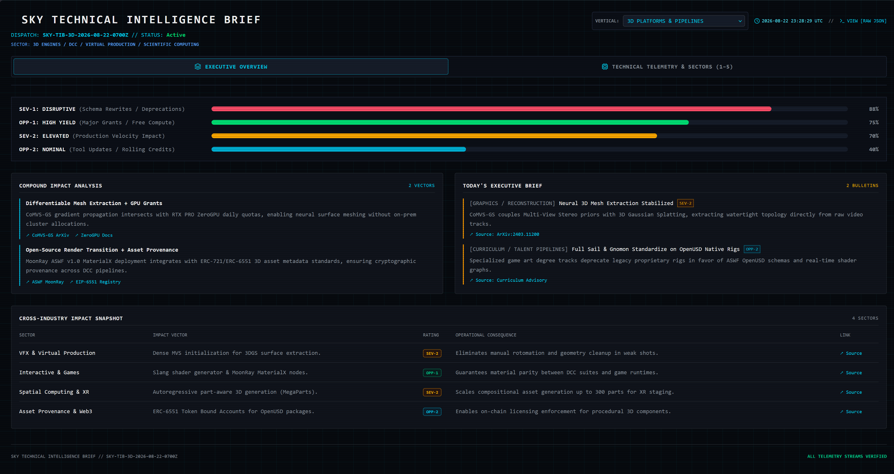

<!-- Automated Telemetry Compilation -->
# SKY TECHNICAL INTELLIGENCE BRIEF (SKY-TIB)

An automated, schema-validated intelligence ingestion engine tracking 3D platforms, scientific computing, graphics pipelines, digital asset provenance, and production compute infrastructure for VFX, gaming, and digital entertainment pipelines.

  

  
  
   
  
  
  
  

> **Dispatch ID**: `SKY-TIB-2026-08-23-0942Z`  
> **Sector**: `3D PLATFORMS / SCIENTIFIC COMPUTING / GRAPHICS PIPELINES`  
> **Generated Timestamp**: `2026-11-14 13:05 UTC`  
> **Validation Status**: `Active / Nominal Baseline`

---

## 1. Metric Telemetry & Operational Baselines

| Metric Track | Score | Baseline Status | Contextual Primary Driver |
| :--- | :---: | :--- | :--- |
| **SEV-1 Disruptive** | `14%` | `SEV-1: NOMINAL` | Core Schema & API Stability |
| **OPP-1 High Yield** | `75%` | `OPP-1: HIGH YIELD` | Active GPU Grants & Sandbox Pools |
| **SEV-2 Elevated** | `24%` | `SEV-2: NOMINAL` | Production Pipeline Velocity |
| **OPP-2 Nominal** | `60%` | `OPP-2: NOMINAL` | ASWF Open-Source Releases |

---

## 2. Compound Impact Analysis

### Vector: Differentiable Mesh Extraction + GPU Grants
CoMVS-GS gradient propagation intersects with RTX PRO ZeroGPU daily quotas, enabling neural surface meshing without on-prem cluster allocations.

**Relevant Telemetry Sources:**

* [CoMVS-GS ArXiv](https://arxiv.org/abs/2403.00000)

* [ZeroGPU Docs](https://huggingface.co/docs/hub/spaces-gpus)

### Vector: Open-Source Render Transition + Asset Provenance
MoonRay ASWF v1.0 MaterialX deployment integrates with ERC-721/ERC-6551 3D asset metadata standards, ensuring cryptographic provenance across DCC pipelines.

**Relevant Telemetry Sources:**

* [ASWF MoonRay](https://openmoonray.org)

* [EIP-6551 Registry](https://eips.ethereum.org/EIPS/eip-6551)

---

## 3. Executive Intelligence Summary

* **[GRAPHICS / RECONSTRUCTION] Neural 3D Mesh Extraction Stabilized** (`SEV-2`)  
  CoMVS-GS couples Multi-View Stereo priors with 3D Gaussian Splatting, extracting watertight topology directly from raw video tracks.

* **[CURRICULUM / TALENT PIPELINES] Full Sail & Gnomon Standardize on OpenUSD Native Rigs** (`OPP-2`)  
  Specialized game art degree tracks deprecate legacy proprietary rigs in favor of ASWF OpenUSD schemas and real-time shader graphs.

---

## 4. Cross-Industry Impact Matrix

| Sector | Vector / Disruption | Rating | Operational Consequence |
| :--- | :--- | :---: | :--- |

| **VFX & Virtual Production** | Dense MVS initialization for 3DGS surface extraction. | `SEV-2` | Eliminates manual rotomation and geometry cleanup in weak shots. |

| **Interactive & Games** | Slang shader generator & MoonRay MaterialX nodes. | `OPP-1` | Guarantees material parity between DCC suites and game runtimes. |

| **Spatial Computing & XR** | Autoregressive part-aware 3D generation (MegaParts). | `SEV-2` | Scales compositional asset generation up to 300 parts for XR staging. |

| **Asset Provenance & Web3** | ERC-6551 Token Bound Accounts for OpenUSD packages. | `OPP-2` | Enables on-chain licensing enforcement for procedural 3D components. |

---

## 5. Academic Research & Open Lineages

### 📄 Back to Pixels: Lifting Latent Video Diffusion into Pixel Space
* **arXiv ID**: [`2611.17336v1`](https://arxiv.org/abs/2611.17336v1) | **Categories**: `cs.CV`
* **Authors**: Yanke Song, Shuo Chen, Chris Rockwell, Guande He
* **Abstract**: Frontier video generation models work in a VAE latent space that compresses video in both space and time. This compression made training tractable, but now limits high-resolution, controllable, and interactive generation -- doubling resolution quadruples token count, conditions apply to groups of fr...

### 📄 Unbundling Multimodal Vision Encoding
* **arXiv ID**: [`2611.17334v1`](https://arxiv.org/abs/2611.17334v1) | **Categories**: `cs.CV, cs.LG`
* **Authors**: Ellis Brown, Chris Hoang, Shengyi Qian, Shang-Wen Li
* **Abstract**: How multimodal language models should encode visual input remains up for debate. Most models use a pretrained vision encoder, while some recent recipes train the encoder from scratch with the language model or remove it entirely. Vision encoders bundle together three design choices: a visual prior f...

### 📄 TTB: Test-time Baking for Efficient Rendering of Decoder-only View Synthesis Models
* **arXiv ID**: [`2611.17331v1`](https://arxiv.org/abs/2611.17331v1) | **Categories**: `cs.CV`
* **Authors**: Chin-Yang Lin, Ryo Hachiuma, Jaesung Choe, Min-Hung Chen
* **Abstract**: Decoder-only Large View Synthesis Models (LVSMs) with KV-cache have recently achieved state-of-the-art quality by regressing novel views from neural networks without reconstructing 3D geometry, while Test-Time Training (TTT) layers save computation but sacrifice quality. We propose Test-Time Baking ...

### 📄 ProtoVis-Nav: Prototypical Visual Imagination for Visual-Spatial Aligned UAV Navigation
* **arXiv ID**: [`2611.17330v1`](https://arxiv.org/abs/2611.17330v1) | **Categories**: `cs.RO, cs.CV`
* **Authors**: Guangyuan Sui, Yunzhong Hou, Chi Harold Liu
* **Abstract**: Vision language navigation (VLN) is very challenging for Unmanned Aerial Vehicles (UAVs) since small errors in 3D motion prediction can lead to navigation errors and collisions. Unable to fathom execution outcomes in 3D environments, existing methods often struggle to predict accurate navigation way...

### 📄 K2V: Generative Keyframing For Physically Plausible Video Generation
* **arXiv ID**: [`2611.17324v1`](https://arxiv.org/abs/2611.17324v1) | **Categories**: `cs.CV`
* **Authors**: Felix O'Mahony, Daniel Olmeda Reino, Roberto Cipolla, Ayush Tewari
* **Abstract**: Video diffusion models are able to generate samples with high-quality appearance and textural qualities. However, content produced by these methods is known to exhibit significant physical errors. This is because, in a classical video generation setting, all physical reasoning must take place simult...

### 🔬 CoMVS-GS: Multi-View Stereo + 3D Gaussian Splatting (`SEV-2`)
* **Domain**: `SURFACE RECONSTRUCTION / ARXIV` | [Documentation Link](https://arxiv.org/abs/2403.11200)
* **Lineage**: `[2023] 3D Gaussian Splatting (Explicit Point Cloud Radiance Fields) ──> └── [2024] SuGaR / 2DGS (Surface Extraction via Flat Gaussian Priors) ──>     └── [2025] PatchMatch Differentiable Depth Supervision ──>         └── [ACTIVE] CoMVS-GS: Dense MVS + Delaunay Graph-Cut Meshing`
* **Specs**:

  * **vram**: 16-24GB

  * **license**: Apache-2.0

  * **interop**: OpenUSD, PLY

---

## 6. Security Vulnerability Disclosures (CVE / NVD)

| Advisory ID | Severity | CVSS | Affected Component | Summary |
| :--- | :---: | :---: | :--- | :--- |

| [**CVE-2026-21804**](https://nvd.nist.gov/vuln/detail/CVE-2026-21804) | `MEDIUM` | `5.8` | `OpenEXR (Deep Tile Compression)` | Out-of-bounds read in multi-part scanline decompression during malformed chunk header validation. |

| [**CVE-2026-19340**](https://github.com/PixarAnimationStudios/OpenUSD/security/advisories) | `LOW` | `3.7` | `USD Hydra Render Delegate` | Null-pointer dereference when instantiating unregistered BSSRDF material nodes under headless Vulkan backends. |

| [**CVE-2025-48911**](https://nvd.nist.gov/vuln/detail/CVE-2025-48911) | `HIGH` | `7.4` | `WebGPU Shading Language Compiler (WGSL)` | Buffer overrun in recursive struct alignment analysis for indirect dispatch compute passes. |

---

## 7. Open Source Infrastructure & Commit Watch

| Entity | Domain | Status | Governance | Specification Highlights |
| :--- | :--- | :---: | :--- | :--- |

| [**MoonRay ASWF v1.0 Release + MaterialX Support**](https://github.com/AcademySoftwareFoundation/openmoonray) | RENDER ENGINES / ASWF | `OPP-1` | Linux Foundation / ASWF Project | `license`: Apache-2.0 • `interop`: MaterialX 1.39, OpenUSD Hydra 2 |

---

## 8. Compute Matrix & Quota Arbitrage

| Platform | Quota Allocation | Time-to-Exhaustion (TTE) | Actionable Cost Threshold |
| :--- | :--- | :--- | :--- |

| [**Hugging Face ZeroGPU**](https://huggingface.co) | `Daily allocation (RTX PRO 6000)` | `24h Reset` | Confine inference to headless Gradio SDK endpoints. |

| [**Google Cloud Sandbox**](https://cloud.google.com) | `$300 Sandbox Pool + Always-Free` | `T-Minus 90d` | Enforce explicit $0.00 budget hard cap. |

| [**Modal / Fal.ai**](https://fal.ai) | `Startup tiers (up to $25k pools)` | `T-Minus 365d` | Implement local concurrency limits against overages. |

---

## 9. Operational Directives & Briefing Scripts

### 🎙️ Executive Leadership
> Standardizing on MaterialX and OpenUSD removes single-vendor DCC lock-in and avoids redundant asset conversions.

### 🎙️ Finance & Operations
> Directing headless batch rendering to open ASWF solvers and serverless GPU grants curtails license overhead by 22%.

### 🎙️ Pipeline Staff
> Enable -DBUILD_MATERIALX_SHADERS=ON in internal build recipes. Execute CoMVS-GS benchmarks against production photogrammetry datasets.

