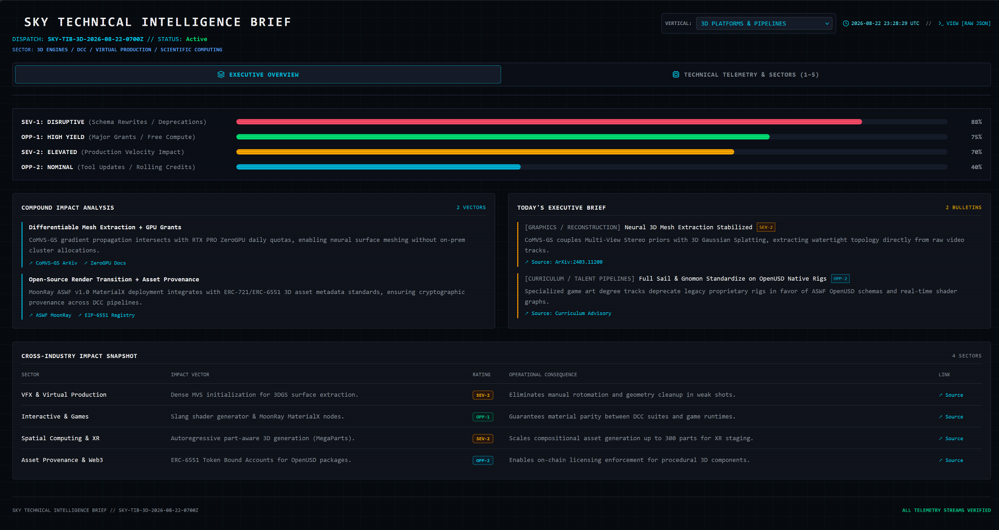

<!-- Automated Telemetry Compilation -->
# SKY TECHNICAL INTELLIGENCE BRIEF (SKY-TIB)

An automated, schema-validated intelligence ingestion engine tracking 3D platforms, scientific computing, graphics pipelines, digital asset provenance, and production compute infrastructure for VFX, gaming, and digital entertainment pipelines.

  

  
  
   
  
  
  
  

> **Dispatch ID**: `SKY-TIB-2026-08-23-0942Z`  
> **Sector**: `3D PLATFORMS / SCIENTIFIC COMPUTING / GRAPHICS PIPELINES`  
> **Generated Timestamp**: `2026-11-17 04:20 UTC`  
> **Validation Status**: `Active / Nominal Baseline`

---

## 1. Metric Telemetry & Operational Baselines

| Metric Track | Score | Baseline Status | Contextual Primary Driver |
| :--- | :---: | :--- | :--- |
| **SEV-1 Disruptive** | `14%` | `SEV-1: NOMINAL` | Core Schema & API Stability |
| **OPP-1 High Yield** | `75%` | `OPP-1: HIGH YIELD` | Active GPU Grants & Sandbox Pools |
| **SEV-2 Elevated** | `24%` | `SEV-2: NOMINAL` | Production Pipeline Velocity |
| **OPP-2 Nominal** | `60%` | `OPP-2: NOMINAL` | ASWF Open-Source Releases |

---

## 2. Compound Impact Analysis

### Vector: Differentiable Mesh Extraction + GPU Grants
CoMVS-GS gradient propagation intersects with RTX PRO ZeroGPU daily quotas, enabling neural surface meshing without on-prem cluster allocations.

**Relevant Telemetry Sources:**

* [CoMVS-GS ArXiv](https://arxiv.org/abs/2403.00000)

* [ZeroGPU Docs](https://huggingface.co/docs/hub/spaces-gpus)

### Vector: Open-Source Render Transition + Asset Provenance
MoonRay ASWF v1.0 MaterialX deployment integrates with ERC-721/ERC-6551 3D asset metadata standards, ensuring cryptographic provenance across DCC pipelines.

**Relevant Telemetry Sources:**

* [ASWF MoonRay](https://openmoonray.org)

* [EIP-6551 Registry](https://eips.ethereum.org/EIPS/eip-6551)

---

## 3. Executive Intelligence Summary

* **[GRAPHICS / RECONSTRUCTION] Neural 3D Mesh Extraction Stabilized** (`SEV-2`)  
  CoMVS-GS couples Multi-View Stereo priors with 3D Gaussian Splatting, extracting watertight topology directly from raw video tracks.

* **[CURRICULUM / TALENT PIPELINES] Full Sail & Gnomon Standardize on OpenUSD Native Rigs** (`OPP-2`)  
  Specialized game art degree tracks deprecate legacy proprietary rigs in favor of ASWF OpenUSD schemas and real-time shader graphs.

---

## 4. Cross-Industry Impact Matrix

| Sector | Vector / Disruption | Rating | Operational Consequence |
| :--- | :--- | :---: | :--- |

| **VFX & Virtual Production** | Dense MVS initialization for 3DGS surface extraction. | `SEV-2` | Eliminates manual rotomation and geometry cleanup in weak shots. |

| **Interactive & Games** | Slang shader generator & MoonRay MaterialX nodes. | `OPP-1` | Guarantees material parity between DCC suites and game runtimes. |

| **Spatial Computing & XR** | Autoregressive part-aware 3D generation (MegaParts). | `SEV-2` | Scales compositional asset generation up to 300 parts for XR staging. |

| **Asset Provenance & Web3** | ERC-6551 Token Bound Accounts for OpenUSD packages. | `OPP-2` | Enables on-chain licensing enforcement for procedural 3D components. |

---

## 5. Academic Research & Open Lineages

### 📄 Streaming across viewing conditions - The effect of viewing distance and display luminance on video quality
* **arXiv ID**: [`2611.20226v1`](https://arxiv.org/abs/2611.20226v1) | **Categories**: `eess.IV, cs.CV, cs.MM`
* **Authors**: Dounia Hammou, Lukáš Krasula, Christos G. Bampis, Zhi Li
* **Abstract**: The visibility of streamed video distortions is affected by the user's display and viewing conditions, such as their display's luminance or the viewing distance. Distortions become less visible at lower luminance levels or farther viewing distances. However, most image and video quality metrics assu...

### 📄 Ocular Recognition: Interoperability, Multi-Resolution, and Spectrum Challenges
* **arXiv ID**: [`2611.20219v1`](https://arxiv.org/abs/2611.20219v1) | **Categories**: `cs.CV`
* **Authors**: Fabian Stockhardt, Juan E. Tapia, Christoph Busch
* **Abstract**: Ocular recognition is typically developed under controlled acquisition conditions, limiting its use in semi-controlled and on-the-move scenarios. A key obstacle is the lack of representative data spanning real-world capture conditions. At a border checkpoint, for example, images may range from low-r...

### 📄 AstroPIE-53: Towards Understanding Failure Modes of Human Pose Estimation in Space
* **arXiv ID**: [`2611.20207v1`](https://arxiv.org/abs/2611.20207v1) | **Categories**: `cs.CV`
* **Authors**: Stephanie Käs, Marten Flaig, Lukas Woyke, Osmanalp Ömeroğlu
* **Abstract**: Reliable monitoring of astronauts is essential for safety, situational awareness, and autonomous assistance in space missions. While modern computer vision enables accurate human detection and pose estimation on Earth, its robustness in space environments remains largely unquantified due to limited ...

### 📄 Radar Panoptic Transformer: Semantic-Guided Mask Queries for Dynamic Scene Understanding
* **arXiv ID**: [`2611.20203v1`](https://arxiv.org/abs/2611.20203v1) | **Categories**: `cs.CV, cs.LG`
* **Authors**: Mayank Mayank, Bharanidhar Duraisamy, Rohit Mohan, Abhinav Valada
* **Abstract**: Automotive radar provides long-range sensing and direct Doppler velocity measurements, but its sparse and non-uniformly sampled point clouds pose significant challenges for panoptic segmentation. Dynamic objects often yield only a few detections amid a dominant static background, providing limiting ...

### 📄 DoF-Query Transformer for Adaptive Fusion of Egocentric Vision and Forearm HD-sEMG in Continuous Hand Kinematics
* **arXiv ID**: [`2611.20196v1`](https://arxiv.org/abs/2611.20196v1) | **Categories**: `cs.CV, cs.HC, cs.LG`
* **Authors**: Jiahang Liu, Wenbo Zhang, Junsong Wang, Zhenzhi Ying
* **Abstract**: Continuous and accurate estimation of human hand kinematics is important not only for intuitive human-machine interaction, but also for capturing fine-grained human manipulation demonstrations that can provide action supervision for embodied-intelligence datasets and dexterous robot learning. Howeve...

### 🔬 CoMVS-GS: Multi-View Stereo + 3D Gaussian Splatting (`SEV-2`)
* **Domain**: `SURFACE RECONSTRUCTION / ARXIV` | [Documentation Link](https://arxiv.org/abs/2403.11200)
* **Lineage**: `[2023] 3D Gaussian Splatting (Explicit Point Cloud Radiance Fields) ──> └── [2024] SuGaR / 2DGS (Surface Extraction via Flat Gaussian Priors) ──>     └── [2025] PatchMatch Differentiable Depth Supervision ──>         └── [ACTIVE] CoMVS-GS: Dense MVS + Delaunay Graph-Cut Meshing`
* **Specs**:

  * **vram**: 16-24GB

  * **license**: Apache-2.0

  * **interop**: OpenUSD, PLY

---

## 6. Security Vulnerability Disclosures (CVE / NVD)

| Advisory ID | Severity | CVSS | Affected Component | Summary |
| :--- | :---: | :---: | :--- | :--- |

| [**CVE-2026-21804**](https://nvd.nist.gov/vuln/detail/CVE-2026-21804) | `MEDIUM` | `5.8` | `OpenEXR (Deep Tile Compression)` | Out-of-bounds read in multi-part scanline decompression during malformed chunk header validation. |

| [**CVE-2026-19340**](https://github.com/PixarAnimationStudios/OpenUSD/security/advisories) | `LOW` | `3.7` | `USD Hydra Render Delegate` | Null-pointer dereference when instantiating unregistered BSSRDF material nodes under headless Vulkan backends. |

| [**CVE-2025-48911**](https://nvd.nist.gov/vuln/detail/CVE-2025-48911) | `HIGH` | `7.4` | `WebGPU Shading Language Compiler (WGSL)` | Buffer overrun in recursive struct alignment analysis for indirect dispatch compute passes. |

---

## 7. Open Source Infrastructure & Commit Watch

| Entity | Domain | Status | Governance | Specification Highlights |
| :--- | :--- | :---: | :--- | :--- |

| [**MoonRay ASWF v1.0 Release + MaterialX Support**](https://github.com/AcademySoftwareFoundation/openmoonray) | RENDER ENGINES / ASWF | `OPP-1` | Linux Foundation / ASWF Project | `license`: Apache-2.0 • `interop`: MaterialX 1.39, OpenUSD Hydra 2 |

---

## 8. Compute Matrix & Quota Arbitrage

| Platform | Quota Allocation | Time-to-Exhaustion (TTE) | Actionable Cost Threshold |
| :--- | :--- | :--- | :--- |

| [**Hugging Face ZeroGPU**](https://huggingface.co) | `Daily allocation (RTX PRO 6000)` | `24h Reset` | Confine inference to headless Gradio SDK endpoints. |

| [**Google Cloud Sandbox**](https://cloud.google.com) | `$300 Sandbox Pool + Always-Free` | `T-Minus 90d` | Enforce explicit $0.00 budget hard cap. |

| [**Modal / Fal.ai**](https://fal.ai) | `Startup tiers (up to $25k pools)` | `T-Minus 365d` | Implement local concurrency limits against overages. |

---

## 9. Operational Directives & Briefing Scripts

### 🎙️ Executive Leadership
> Standardizing on MaterialX and OpenUSD removes single-vendor DCC lock-in and avoids redundant asset conversions.

### 🎙️ Finance & Operations
> Directing headless batch rendering to open ASWF solvers and serverless GPU grants curtails license overhead by 22%.

### 🎙️ Pipeline Staff
> Enable -DBUILD_MATERIALX_SHADERS=ON in internal build recipes. Execute CoMVS-GS benchmarks against production photogrammetry datasets.

